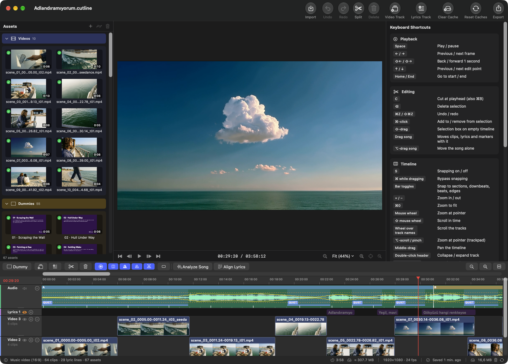

# Cutline

A simple, native macOS video editor made for music videos: cut your footage to the song, time the lyrics word by word, and export for YouTube, TikTok, Reels, Shorts or a paid ad.



## What it's for

General editors are built for every kind of video. Cutline does one job: building a music video around a finished song. The song drives everything. Cutline finds its beats, bars and sections, so cuts and markers snap to the music. It separates the vocals, and lines the lyrics up with them word by word, so the words appear as they're sung. The same song can become a 16:9 music video, a 9:16 social cut and a 30-second ad, each with its own limits and export settings.

Everything runs on your Mac. The analysis is offline; the only download is a one-time set of models.

## What it can do

**Projects**
- Three project types, chosen when you create a project:
  - **Music video**: 16:9, HD or 4K, no length limit, H.265.
  - **Portrait social**: 9:16, 1080×1920, up to 3 minutes, H.264.
  - **Portrait ad**: 9:16, 1080×1920, up to 30 seconds, H.264, with a file-size target.
- Length limits, codecs and export defaults are editable in Settings > Presets.
- Import from Project: start a new format with another project's song, lyric timing, clips and tracks (a one-time copy).
- Panel sizes and track heights are saved with each project.

**Editing**
- Assets panel with thumbnails: videos, images (PNG with transparency), the song and lyrics TXT files.
- Live preview with frame stepping, zoom and pan; drag clips in the preview to move and scale them.
- One audio track and any number of video and lyrics tracks; mute the song, hide any track.
- Trim, split, move and group-drag clips, with snapping to sections, downbeats, beats, edges and the playhead.
- Per-clip size and position (Fill or Fit), horizontal flip, and filters: Color (hue, saturation, contrast, brightness) and Fade, each with an on/off switch.
- Proxies (½, ¼, ⅛ size) for smooth preview of heavy footage; export always uses the originals.
- Cinemascope bars for music videos: animated from 16:9 to 2.35:1 between two markers on the timeline.

**The song**
- Waveform, loudness curve with loud and quiet stretches, beats, downbeats and song sections, drawn on the audio track.
- Correct a downbeat or a section by dragging it; your fixes are kept apart from the raw analysis.
- Dragging the song moves the clips, lyrics and markers with it.

**Lyrics**
- Drop a TXT on a lyrics track: one item per line, with each word inside it.
- Automatic word timing from the vocals (forced alignment, checked against speech recognition), with a confidence for every word.
- Fix the unsure ones fast: N jumps to the next unsure word and loops the song around it, T taps words in time to the music, and confirmed words act as anchors for the words between them.
- Multi-line lyrics: lines on different tracks show at the same time.
- One font, size and color, a drop shadow (blur, offset, color, strength), quick fades or letter-by-letter animation, and lead-in / lead-out times.
- Placement with alignment, padding, line width and wrapping. In portrait projects lyrics keep clear of where TikTok, Reels and Shorts draw their buttons.

**Export**
- H.265 or H.264, with constant quality, a target bitrate, or a target file size (Cutline picks the bitrate and re-encodes if the file comes out too big).
- A live budget bar for length and file size.
- A render cache: a re-export only encodes the parts an edit changed.

**Placeholders and Claude**
- Dummies: colored placeholder cards (title, scene description, length) for shots that don't exist yet.
- A local control channel lets Claude place one dummy per scene of a production document, with your approval each time it connects. It can add tracks and dummies; it never deletes tracks or touches the song or lyrics.

## Installing

Download Cutline from the [latest release](https://github.com/emrahgunduz/Cutline/releases/latest). It needs a Mac with Apple Silicon and macOS 15 or later.

Cutline is signed ad-hoc rather than with an Apple Developer ID, and Apple hasn't notarized it. So the first time you open it, macOS blocks it with a message that Apple couldn't verify it. That's expected for apps distributed this way. The checksum file lets you confirm you have exactly the file that was published here.

1. From the release, download `Cutline-1.0.<n>.zip` and `Cutline-1.0.<n>.zip.sha256`.
2. Optional: check the download. In Terminal, in the folder you downloaded to, run the line below (with your version number). It should print `OK`.

   ```bash
   shasum -a 256 -c Cutline-1.0.<n>.zip.sha256
   ```

3. Unzip it, and move `Cutline.app` to your Applications folder.
4. Let macOS open it, in one of two ways:
   - **In Terminal:** remove the quarantine mark that macOS put on the download, then open Cutline as usual.

     ```bash
     xattr -dr com.apple.quarantine /Applications/Cutline.app
     ```

   - **In System Settings:**
     1. Open Cutline. When macOS says it can't be opened, click **Done**.
     2. Go to **System Settings → Privacy & Security** and scroll to **Security**.
     3. Next to the line saying Cutline was blocked, click **Open Anyway**, then confirm with your password or Touch ID.
     4. Click **Open** in the dialog that follows.

     Since macOS 15, Control-clicking the app and choosing Open no longer gets past this.
5. On first launch, Cutline offers to download its analysis models (below).

Each new version you download needs step 4 again. Your projects, settings and models stay where they are.

## The analysis models

Song analysis and lyric alignment use four models: HTDemucs (vocal separation), Beat This! (beats and downbeats), the MMS forced aligner and Whisper medium. They're about 3 GB and are not inside the app.

The first time you open Cutline, the New Project window offers to download them. They go to `~/Library/Application Support/Cutline/models`, or to a folder you choose (for example on another disk). A folder that already has them is used as is. The download can be paused and resumed, and every file is checked before use. Until the models are ready, projects can't be created or opened. Settings > Models shows where they are and can move, re-download or remove them.

## Requirements

- A Mac with Apple Silicon, macOS 15 or later.
- To build: Xcode, [XcodeGen](https://github.com/yonaskolb/XcodeGen) and [uv](https://github.com/astral-sh/uv) (for the Python runtime).

## Building

```bash
scripts/build_python_runtime.sh   # once: the Python runtime into build/ml, and a development copy of the models into build/ml/models
scripts/build_release.sh          # the Release app
```

`scripts/build_release.sh` builds the Python runtime when it's missing or its lock file changed, then the Release app. It re-signs the app (ad-hoc), zips it, and runs a smoke test. The test checks that the app's bundled helper works in a clean environment and refuses the network. Then it analyses a short synthetic song and aligns lyrics on it, with internet access blocked.

- `--clean` rebuilds everything, including the Python runtime. It keeps the models in `build/ml/models`.
- `--no-smoke` skips the analysis part of the smoke test.
- `--open` opens the app when done.

The results go to `build/Release`:
- `Cutline.app`
- `Cutline.app.dSYM` (symbols for crash logs; the app's binary is stripped)
- `Cutline.zip` and `Cutline.zip.sha256`

Run `xcodegen generate` after adding, moving or removing source files; the build scripts run it too.

### GitHub CI and releases

Both workflows run only when started by hand: **Actions → CI** (or **Release**) **→ Run workflow**, then pick the branch.

- **CI** (`.github/workflows/ci.yml`) runs the helper tests and the app tests on an Apple Silicon runner. To run it on every pull request, add a `pull_request` trigger.
- **Release** (`.github/workflows/release.yml`) runs `scripts/build_release.sh --clean`, smoke test included, and publishes a GitHub Release.
  - The release has the app as `Cutline-1.0.<n>.zip`, its `.sha256` file (works with `shasum -a 256 -c`), the zipped dSYM, and install notes.
  - The app isn't notarized. After downloading, run `xattr -dr com.apple.quarantine Cutline.app` once.
  - The models used by the smoke test are cached between runs.

### Versions

Every build is versioned `1.0.<n>`, and its build number is `<n>`:

- **GitHub releases:** `<n>` is the Release workflow's run number. The tag is `v1.0.<n>`, on the chosen branch's commit.
- **Local builds** (Debug, Release and test builds): `<n>` counts up in `build/build-number`, which isn't tracked in git. To set a version yourself: `APP_VERSION=1.0.42 APP_BUILD=42 scripts/build_release.sh`.

Local and GitHub numbers are counted separately, so the same number can mean different builds.

### Tests

```bash
xcodebuild test -project Cutline.xcodeproj -scheme Cutline -destination 'platform=macOS,arch=arm64'
```

```bash
PYTHONPATH=build/ml-dev build/ml/python/bin/python3 -B -m pytest -c helper/pytest.ini --rootdir helper helper/tests
```

## Project layout

| Folder | What's in it |
|---|---|
| `Cutline/App` | App start, menus, the project document, the main window, toolbar and status bar |
| `Cutline/Assets` | Assets panel, importing, thumbnails, waveforms, proxies |
| `Cutline/Preview` | The live preview and the player behind it |
| `Cutline/Timeline` | Timeline view, layout, snapping, lyric correction |
| `Cutline/Inspector` | The right-hand inspector: clips, lyrics, keyboard shortcuts |
| `Cutline/Model` | The project data model and editing commands |
| `Cutline/Render` | Compositor, frame and lyric rendering, render cache keys |
| `Cutline/Export` | Export, size estimate and the file-size solver |
| `Cutline/Analysis` | Runs the Python helper: song analysis and lyric alignment |
| `Cutline/Analysis/Models` | The analysis models: list, folder state, download, the New Project card |
| `Cutline/Control` | The control channel Claude uses |
| `Cutline/Dialogs` | New Project, New Dummy, Export and Reset Caches |
| `Cutline/Settings` | The Settings window: Presets and Models |
| `Cutline/Resources` | Format presets, platform UI zones, the document icon |
| `CutlineTests` | Unit and integration tests |
| `Tools/cutline-ctl` | Command-line client for the control channel, shipped inside the app and linked to `~/Library/Application Support/Cutline/cutline-ctl` when Cutline opens |
| `helper` | The offline Python helper, its pinned requirements, the model list and its tests |
| `scripts` | Build scripts: Python runtime, Release app, smoke test, version stamp, icons, model download |
| `docs` | The glossary, the original plan, the Claude skill and README images |
| `.github/workflows` | CI and Release workflows (manual) |

`build/` isn't tracked. `build/ml` holds the Python runtime that's copied into the app, plus a development copy of the models.

## Docs

- [docs/GLOSSARY.md](docs/GLOSSARY.md): the name and meaning of every part of the app, from the toolbar to tap mode.
- [docs/claude-skill/cutline-dummies](docs/claude-skill/cutline-dummies/SKILL.md): the Claude skill that turns a production document into dummies on the timeline, and reads their times back.
