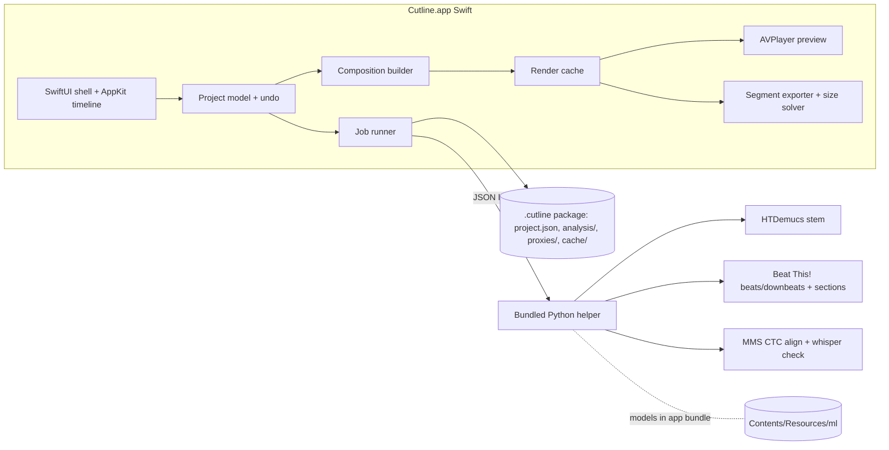

# Cutline Editor - Plan

## Goal Capsule

- **Objective:** One person can take a song, footage, PNGs and a lyrics TXT and produce a finished music video or portrait social/ad cut on an Apple Silicon Mac. Word-level lyric timing has to land right, and exports have to stay within each format's length and size limits, without the trial and error a full NLE needs.
- **Product authority:** The user (sole editor and only user). Source requirements come from the user's original brief, the ideation doc (`/tmp/compound-engineering-501/ce-ideate/a3f19c7e/2026-11-04-music-video-editor-ideation.html`, temporary) and this brainstorm.
- **Means:** A native SwiftUI/AppKit app on AVFoundation with a Core Image/Metal compositor. It bundles an offline Python helper with pre-downloaded models for music analysis and lyric alignment (KTD1, KTD4).
- **Open blockers:** None.
- **Stop conditions:** Stop and ask the user if a requirement can't be met on the M1 test machine as written, for example realtime HD preview failing even with proxies. Also stop if a Product Contract decision proves infeasible.
- **Execution profile:** Three PRs in dependency order (see Implementation Units). The executing agent builds and verifies each PR, and the user merges.
- **Product Contract preservation:** changed: R32 — it now says preview and export share the keying and invalidation logic rather than stored frames, because preview frames (from proxies) can't serve a full-quality export. No change in what the user experiences.

## Product Contract

### Summary

Cutline is a native macOS editor for Apple Silicon. It has an assets panel, a realtime preview, an inspector and a timeline. The timeline holds one audio track whose beats and sections form the snap grid, N video tracks, and N lyric tracks of lines and words. Lyrics are aligned automatically from the TXT, and the user fixes the uncertain words by tapping in time. There are three project types (music video, portrait social, portrait ad), each with its own length limit, codec and export budget.

### Problem Frame

The user edits their own music videos and used After Effects for the sample project (`Example_Music_Video/`). General NLEs are far heavier than the job needs, yet they handle the user's most expensive task badly: timing every lyric word, which in the sample was done by hand. Making portrait social and ad cuts adds another loop of export, check length and size, and re-export. The songs can be in Turkish (the sample lyrics are Turkish), so lyric tooling can't assume English.

### Key Decisions

- **Separate projects per deliverable, with one-time import.** A portrait project can copy audio, lyric timing and clips from another project, and nothing stays linked after that. Governs R40. (session-settled: user-directed — chosen over linked variants that propagate edits: linked variants add override and undo complexity the user doesn't need.)
- **Length limits are fixed per project type: music video unlimited, social 3 min, ad 30 s.** Governs R35. (session-settled: user-directed — chosen over a per-platform minimum such as a 90 s Reels limit: the user has uploaded 2–3 min Reels without problems, and YouTube Shorts allows 3 min.)
- **Codec by project type: H.265 for music video, H.264 for social and ads.** Governs R36. (session-settled: user-approved — chosen over H.265 everywhere: platforms re-encode uploads, and H.264 is the safe upload format.)
- **Multiple lyric tracks.** Lines on different lyric tracks can be on screen at the same time, which is how multi-line lyrics are shown. Governs R17, R18. (session-settled: user-directed — chosen over a single lyric track.)
- **Proxies are optional, one per video, and preview-only.** Governs R7–R9. (session-settled: user-directed — chosen over automatic proxies for everything: the user decides which clips need one.)
- **Alignment, not transcription, run on-device.** The TXT is ground truth. The app only finds when each known word is sung, works offline, and supports Turkish. Governs R20–R22.
- **Correction is the core lyric feature.** No aligner is perfect on sung vocals, so fast keyboard correction matters more than squeezing extra model accuracy. Governs R23–R25.
- **The song is the timeline grid.** Beats, downbeats and sections are snap targets, and markers are anchored to audio time. Governs R13–R15.
- **Preview and export share one cache keying and invalidation scheme.** Invalidation is exact per time range. Governs R32–R34.

### Requirements

**Projects and layout**

- R1. A new project asks for the project type: Music video (16:9, 1920×1080 or 3840×2160), Portrait social (9:16, 1080×1920) or Portrait ad (9:16, 1080×1920).
- R2. The window has four regions: assets (left), preview (center), inspector (right) and timeline (bottom). Every divider is resizable, and the layout is saved and restored per project.
- R3. Project length runs from 0 to whichever ends later, the audio or the last video clip. Areas with no clip show black, and the background color isn't configurable.
- R4. When nothing is selected, the inspector lists keyboard shortcuts grouped by app section (assets, preview, timeline, lyrics, export).

**Assets and ingest**

- R5. The assets panel accepts video files, image files (PNG with alpha respected) and one TXT lyrics file per project, and shows a thumbnail for each video and image.
- R6. On import, the app computes video thumbnails and the audio's waveform, beats, downbeats, sections and vocal stem once in the background, with visible per-asset progress. Reopening the project reuses the results without recomputing.
- R7. The user can create a proxy for any video at 1/2, 1/4 or 1/8 resolution. Proxies are low-quality H.265 in music-video projects and H.264 in social and ad projects.
- R8. Each video has at most one proxy. Creating a new one replaces the existing proxy, and a proxy can be deleted. The assets panel shows whether a video has a proxy and at what size.
- R9. Proxies are used only for preview. Export always reads the original media.

**Preview**

- R10. The preview plays the current timeline in realtime at project frame rate, with play/pause, go to start, go to end, and one-frame step back and forward.
- R11. The preview always reflects the latest edit, so a stale frame never shows after a change.

**Timeline**

- R12. The timeline zooms continuously from single-frame precision out to the whole project length.
- R13. One audio track holds the song, which can be dropped in, replaced or removed. It shows the waveform, beat and downbeat ticks, and loud/quiet regions.
- R14. A section lane above the waveform shows detected song sections (for example verse and chorus), and the user can adjust section boundaries and individual downbeats.
- R15. Clip edges, cuts, lyric lines and words, and the cinemascope markers snap to beats, downbeats and section edges. A modifier key disables snapping. Markers keep their musical position when the analysis is corrected.
- R41. The timeline button bar has a master snapping toggle plus separate toggles for each snap-target group: beats, downbeats, sections, and edges & playhead. The toggles are saved per project, and ⌘ while dragging bypasses all of them.
- R16. Video tracks can be added and removed. Each holds multiple clips (video or image) shown with thumbnails. Clips can be moved, trimmed at either end, split at the playhead and deleted.
- R17. Lyric tracks can be added and removed. Each holds line items, and each line contains word items.
- R18. Lyric lines can be moved between lyric tracks. Lines on different tracks that overlap in time are shown at the same time, stacked in the tracks' vertical order.
- R19. Lines and words can be moved and have their start and end edited, like video clips. A line's span always contains its words.

**Lyrics alignment and correction**

- R20. Generating lyrics from the TXT creates one line item per non-empty TXT line and one word item per word, all on lyric track 1. Blank lines are treated as stanza breaks.
- R21. Each word is timed by aligning the known text against the separated vocal. It runs fully offline and supports Turkish and English at minimum.
- R22. Each word carries an alignment confidence. Low-confidence words are visibly tinted on the timeline.
- R23. A "next uncertain word" command jumps the playhead to the next low-confidence word, which the user hasn't confirmed yet, and loops a short region around it.
- R24. In tap mode, playback runs (optionally slowed with pitch kept) and each keypress sets the start of the current word and moves on to the next word.
- R25. A word the user edits or taps becomes confirmed. Unconfirmed words between two confirmed words are re-timed to fit between them, and confirmed words are never moved automatically.

**Lyrics appearance**

- R26. Words appear with a fast fade in and disappear with a fast fade out, timed to each word's start and end. One project-wide font, size and color applies to all lyrics, with a drop shadow that has blur, x offset, y offset and color.
- R27. Lyrics are placed inside a safe area. In music videos the stacked lyric block stays inside the area left visible by the cinemascope bars at every frame. Portrait projects offer toggleable preview overlays for TikTok, Reels and Shorts UI zones, and the lyric safe area avoids them.

**Clips and filters**

- R28. Every video and image clip has size and position (static, no keyframes).
- R29. When a clip is selected, the inspector lists its filters: hue, saturation, brightness, contrast and fade in/out. Each filter has an on/off switch. Turning it on reveals the filter's controls, and turning it off hides them and removes the effect.

**Cinemascope (music video only)**

- R30. A music-video project has a cinemascope on/off switch and two draggable timeline markers. Before the first marker the frame is full 16:9. Between the markers black bars animate in from the top and bottom, and from the second marker onward the frame is fully 2.35:1.
- R31. Cinemascope isn't available in social or ad projects.

**Render cache**

- R32. Preview and export share one cache keying and invalidation scheme. Preview keeps rendered frames and export keeps encoded segments, and an edit invalidates only the time ranges whose output it changes.
- R33. The timeline shows a cache strip marking valid, stale and uncached ranges.
- R34. Re-exporting after a small edit re-renders only the changed ranges, and a cancelled export can resume.
- R42. A **Clear Cache** button in the window toolbar (and a matching menu item) empties the render cache: preview frames in memory and the encoded export segments on disk. Proxies, thumbnails, waveforms and music analysis are kept. The button shows how much space is used and how much was freed.

**Limits and export**

- R35. Each project type has a maximum length: music video unlimited, portrait social 3:00, portrait ad 0:30. The timeline shows a hard-out line at the limit, and content past it is marked as over. One action trims the end to the nearest downbeat or lyric-line end before the limit.
- R36. Export uses H.265 for music videos (highest quality by default) and H.264 for social and ads. Quality, bitrate and the other relevant settings stay adjustable.
- R37. Social and ad exports can target a maximum file size in MB. The app picks the settings so the result lands at or just under the target, checks the real size and automatically corrects any overshoot.
- R38. A budget indicator shows project length against the limit and, when a size target is set, estimated size against the target while editing.
- R39. Format presets (resolution, length limit, codec, default size target, safe-area zones) are stored as user-editable data.
- R40. A new project can import audio, lyric timing, clips and their track layout from an existing project as a one-time copy.

### Key Flows

- F1. **New music video:** create project (R1) → drop song (R13, R6 analysis) → import TXT and generate lyrics (R20–R22) → correct uncertain words (R23–R25) → lay clips on the beat grid (R15, R16) → set filters and transforms (R28, R29) → place cinemascope markers (R30) → export H.265 (R36).
- F2. **Ad cut from a music video:** create a Portrait ad project (R1) → import from the music-video project (R40) → re-place clips for 9:16 (R28) → watch the 30 s line (R35, R38) → export H.264 to a size target (R37).

### Acceptance Examples

- AE1. Covers R25. Words w1–w5 are unconfirmed. The user taps w1 at 10.00 s and w5 at 12.00 s. w2–w4 re-time to fit inside 10.00–12.00 s in order, and w1 and w5 don't move afterwards.
- AE2. Covers R18. Line A on track 1 spans 5–9 s and line B on track 2 spans 7–11 s. From 7 to 9 s both lines are visible, A stacked above B.
- AE3. Covers R35. An ad project's content ends at 31.4 s. The timeline marks 30.0–31.4 s as over, and the trim action ends the project on the last downbeat or lyric-line end at or before 30.0 s.
- AE4. Covers R37. A 30 s ad exported with a 20 MB target produces a file of at most 20 MB. If the first encode lands at 20.6 MB, the app re-encodes automatically without user action.
- AE5. Covers R9, R11. A clip has a 1/4 proxy. Preview uses the proxy, and export reads the original at full resolution.
- AE6. Covers R27. With cinemascope bars at their maximum, a two-track lyric stack that would overlap the bottom bar is shifted up so that every word is fully visible.
- AE7. Covers R20. Running generation on `Example_Music_Video/Zamansiz Yazgilar.txt` yields one line per non-empty TXT line, with Turkish characters (ş, ğ, ı, ü, ö, ç) kept intact in words.

### Success Criteria

- After auto-alignment of the sample song, the user can bring every word within a frame or two of correct in one listening pass plus a few targeted fixes.
- Scrubbing and playback in an HD project with several video tracks stay realtime on Apple Silicon. Proxies may be used for 4K sources.
- An ad export with a size target lands under the target on the first user action.
- The sample project (`Example_Music_Video/`) can be rebuilt in Cutline end to end.

### Scope Boundaries

- Out: keyframe or other object animation, audio filters or audio mixing, transitions beyond fade in/out, text styles other than the single lyric style, collaboration, cloud features, and platforms other than Apple Silicon macOS.
- Out: linked variants that propagate edits between projects (see Key Decisions).
- Out: a configurable background color.
- Deferred: an automatic beat-paced rough cut from dropped clips.
- Deferred: tempo-map editing beyond moving downbeats and section boundaries.

### Outstanding Questions

- Deferred to Planning: choice of on-device alignment and separation models (for example Whisper-based alignment with a Turkish-capable model, plus a source-separation model), and how they're packaged in the app.
- Deferred to Planning: project frame rate, either taken from the first video or chosen at creation. The default is to take it from the first clip and fall back to 30 fps.
- Deferred to Planning: how to emulate two-pass encoding on VideoToolbox for R37.
- Deferred to Planning: whether the recent platform UI-zone overlay geometry (R27) is sourced or approximated.

### Sources

- Test media: `Example_Music_Video/` (song WAV, 58 footage clips, Turkish lyrics TXT, the finished render and ads for reference). This folder is gitignored.
- Platform limits: YouTube Shorts allows up to 3 minutes (support.google.com/youtube/answer/10059070). TikTok ads have a 500 MB cap (third-party).

---

## Planning Contract

### Key Technical Decisions

- KTD1. **The app is native SwiftUI, and the timeline is drawn by a custom AppKit view.** The shell, panels, inspector and dialogs are SwiftUI. The timeline is an `NSView` (Core Animation/Metal backed) that draws only the visible items and does its own hit-testing. Rationale: thousands of word items as SwiftUI views stutter during zoom and scroll.
- KTD2. **AVFoundation with a custom `AVVideoCompositing` compositor built on Core Image over Metal is the single render path.** Preview uses `AVPlayer`. Export uses AVAssetReader/AVAssetWriter on the same instructions. The composition builder takes a media mode (proxy or original). Instructions express transforms in canvas space and are scaled by each source's resolution, so preview builds from proxies and export from originals. Clip transforms, filters, lyrics and letterbox are evaluated per frame from the instruction data as functions of time. Scrubbing uses zero-tolerance seeks, where a new seek starts only after the previous one finishes, and ±1 frame uses frame stepping. Rationale: one path means preview and export can't disagree (R11, R32). A fully custom Metal player loop is the fallback, and only if seek latency proves unacceptable.
- KTD3. **Lyric lines are rasterized with Core Text and cached per line and style, along with each word's glyph rect, then composited with a Core Image blur shadow.** Each word is composited as a crop of the line raster with its own alpha, so word fades are independent (R26) and kerning is kept. Rationale: preview needs live text, which `AVVideoCompositionCoreAnimationTool` can't provide. Core Text covers the Turkish glyphs. Case changes use the `tr` locale.
- KTD4. **ML runs in a bundled, offline Python helper process.** The runtime and every model weight live inside `Cutline.app/Contents/Resources/` and are fetched at build time, never at runtime, with no user-cache directories. The Swift app starts the helper per job and talks to it over JSON lines on stdin/stdout, showing progress. Rationale: HTDemucs, Beat This! and CTC aligners are mature in Python and fragile as ad-hoc Core ML ports. The user directed that models live in the app folder and that Python is bundled. (session-settled: user-directed — chosen over models in a shared or user cache: everything ships inside the app.) Every library cache variable (`HF_HOME`, `TORCH_HOME`, `XDG_CACHE_HOME`) is pointed into the bundle, and network access is disabled at the helper's start.
- KTD5. **The vocal stem comes from HTDemucs (MIT), run once per song.** It's stored in the project package (R6).
- KTD6. **Beats and downbeats come from Beat This! (MIT).** Sections come from a chroma/MFCC self-similarity novelty curve, plus repeated-stanza hints from the TXT, where blank lines separate stanzas and a repeated stanza marks a chorus. Results are stored as audio-time arrays, and markers reference the nearest beat index so they can follow corrections (R14, R15).
- KTD7. **Alignment is CTC forced alignment of the known text on the vocal stem, with a transcription fallback.** The primary path is the MMS forced aligner (torchaudio MMS_FA, 1000+ languages, CC-BY-NC, acceptable for this personal app), with Turkish text romanized for its vocabulary and mapped back to the original words. Words with low alignment scores are re-checked against faster-whisper word timestamps (multilingual, Turkish included), matched to the known words by edit distance. Each word gets a 0–1 confidence from the CTC posterior and the agreement between the two methods (R21, R22). Rationale: the text is known, so alignment beats transcription, and the second method gives a confidence signal.
- KTD8. **Anchor stretch is a pure function.** Given the ordered words, the confirmed set and the original durations, unconfirmed runs between anchors are rescaled proportionally into the gap, so each word keeps its relative length (R25). It's unit-testable without audio.
- KTD9. **A project is a `.cutline` package directory managed by `NSDocument`.** It holds `project.json` (versioned schema), `layout.json` (panel sizes), `analysis/` (waveform peak pyramid, beats, sections, alignment, vocal stem), `thumbnails/`, `proxies/` and `cache/`. Media is referenced by security-scoped bookmark plus path and never copied. Rationale: NSDocument allows incremental writes, so a multi-MB stem isn't rewritten on every save.
- KTD10. **Proxies are H.265 (music video) or H.264 (social and ad) at 1/2, 1/4 or 1/8 size, with a short GOP.** Keyframes come every 6 frames. (session-settled: user-directed — chosen over ProRes/all-intra proxies: the user wants low-quality H.264/H.265.) Conflict call-out: research shows long-GOP sources slow down exact-frame seeking. The short GOP reduces this. If scrubbing on the M1 still lags, the remedy is shorter GOPs or all-intra H.264, which changes only the proxy encoder settings. Proxy choice is per source and never touches export (R9).
- KTD11. **The render cache is keyed by a content hash per frame range.** The frame key covers source identity and in-point, transform, enabled filter parameters, the visible lyric words and style, the letterbox value and output size. Preview caches decoded composited frames in an in-memory LRU under the frame key plus the proxy flag. Export segments are keyed by the frame keys in their range plus the encoder settings (codec, bit depth, bitrate or quality, DataRateLimits). They're written to `cache/segments/`, reused when the key is unchanged, and the video segments are joined without re-encoding. Only video is segmented. Audio is encoded once for the full length and muxed in a final passthrough step, which avoids AAC priming gaps at the joins. The cache strip shows export-segment state (R32–R34).
- KTD12. **Size-targeted export computes the bitrate, encodes, verifies and corrects up to twice.** The video bitrate is `(target_bytes × 8 − audio_bits) / duration × 0.95`, and `DataRateLimits` caps peaks at about 1.5× over 1 s. After the encode the app measures the file. If it's over the target, it re-encodes with the bitrate scaled by target/actual × 0.97, at most twice, and reports failure if it's still over (R37). A retry changes the encoder settings, so it re-encodes every segment.
- KTD13. **Presets live in a JSON resource that is copied into Application Support on first launch and editable from Settings** (R39). Built-in rows hold the Product Contract limits.
- KTD14. **Frame rate comes from the first video clip added, falling back to 30 fps, and is fixed per project from then on.** Rationale: the sample footage is 24 fps, and the user never asked to pick a rate.
- KTD15. **Undo/redo goes through `NSUndoManager` with every timeline mutation expressed as a command on the project model.**

### High-Level Technical Design



### Output Structure

```
Cutline/
  Cutline.xcodeproj
  Cutline/                      # app target
    App/                        # app entry, document, window layout
    Model/                      # project schema, commands, presets
    Timeline/                   # AppKit timeline view, snapping, zoom
    Render/                     # compositor, instructions, lyrics raster, cache
    Export/                     # writer, segments, size solver
    Assets/                     # import, thumbnails, waveform, proxies
    Analysis/                   # job runner, helper protocol
    Inspector/                  # filters, lyrics style, shortcuts
    Resources/presets.json
  CutlineTests/
  helper/                       # Python helper source
    cutline_helper/
    tests/
    requirements.lock
  scripts/
    build_python_runtime.sh     # bundles python + fetches models at build time
  docs/plans/
```

### Assumptions

- The Python runtime is built from python-build-standalone (arm64) with locked wheels. Models are downloaded once by `scripts/build_python_runtime.sh` into `build/ml/` and copied into the app bundle by a build phase.
- The app runs unsandboxed with hardened runtime off, because it's a personal build that launches a bundled interpreter.

### Risks

- The quality of Turkish romanization in MMS_FA alignment is unproven. Mitigation: the whisper cross-check, confidence tinting and the correction tools (R23–R25). Measure it on the sample song in U8.
- Seek and step latency on long-GOP proxies on the M1 (see KTD10).
- The app bundle grows by about 2–3 GB because of the models and runtime. Accepted for a personal app.
- The M1 hardware encoder may not strictly follow the rate limits. The verify-and-correct loop (KTD12) covers this.
- Joining independently encoded VideoToolbox segments without re-encoding may produce mismatched parameter sets. U14 starts with a spike to check this. If it fails, the fallback is to re-encode on export with segment reuse turned off, keeping the cache for preview.
- faster-whisper runs on the CPU (no Metal), so the first lyric generation for a 4-minute song may take several minutes on the M1. This is accepted, and the job shows progress.

---

## Implementation Units

### PR 1 — Core editor

Waits on: nothing.

### U1. App skeleton, project package and layout

**Goal:** A document-based app that creates, saves and reopens `.cutline` projects with the type chosen at creation and the four-panel layout persisted.
**Requirements:** R1, R2, R3, R4
**Dependencies:** none
**Files:** `Cutline.xcodeproj`, `Cutline/App/CutlineApp.swift`, `Cutline/App/ProjectDocument.swift`, `Cutline/App/MainWindowView.swift`, `Cutline/Model/Project.swift`, `Cutline/Model/ProjectType.swift`, `Cutline/Model/Presets.swift`, `Cutline/Resources/presets.json`, `Cutline/Inspector/ShortcutsView.swift`, `CutlineTests/ProjectCodingTests.swift`
**Approach:** NSDocument package per KTD9. New project sheet (R1). The split views save their sizes to `layout.json`. Presets load per KTD13. The shortcuts view is grouped by section. Project length follows R3.
**Test scenarios:**
- Encoding and decoding a project with every track kind round-trips equal.
- A new ad project has 1080×1920 and a 30 s limit from the presets.
- Reopening restores the panel sizes.
- A schema version mismatch fails with a readable error.
- Project length is max(audio end, last clip end), and is 0 when empty.
**Verification:** Creating, saving, quitting and reopening shows the same type and layout.

### U2. Asset import, thumbnails, waveform and proxies

**Goal:** Import video, image and TXT assets with thumbnails, build the audio waveform pyramid, and manage per-video proxies.
**Requirements:** R5, R6 (thumbnail and waveform parts), R7, R8
**Dependencies:** U1
**Files:** `Cutline/Assets/AssetLibrary.swift`, `Cutline/Assets/ThumbnailGenerator.swift`, `Cutline/Assets/WaveformBuilder.swift`, `Cutline/Assets/ProxyManager.swift`, `Cutline/App/AssetsPanelView.swift`, `CutlineTests/WaveformBuilderTests.swift`, `CutlineTests/ProxyManagerTests.swift`
**Approach:** Bookmarks per KTD9. Thumbnails come from the async image generator with tolerance and are stored in `thumbnails/`. The waveform is a vDSP min/max/RMS pyramid at 256, 2048 and 16384 samples per bucket. Proxy encoding follows KTD10, writing to `proxies/<asset-id>.mov`. A second create replaces the existing proxy, and delete removes it. Only one TXT is allowed per project, and importing another replaces it after confirmation.
**Test scenarios:**
- The waveform of a known sine file has the expected peak per bucket.
- Creating a 1/4 proxy and then a 1/2 proxy leaves one file at 1/2 size.
- Deleting a proxy removes the file and the badge.
- A PNG with alpha keeps its alpha channel in the thumbnail and the frame.
**Verification:** Importing `Example_Music_Video/Footage/` shows 58 thumbnailed clips. The WAV waveform appears within seconds.

### U3. Timeline view and editing

**Goal:** A zoomable timeline with the audio track, N video tracks and N lyric tracks, supporting move, trim, split, delete, add/remove track and undo.
**Requirements:** R12, R13 (display, replace, remove), R16, R17, R18, R19
**Dependencies:** U1, U2
**Files:** `Cutline/Timeline/TimelineView.swift`, `Cutline/Timeline/TimelineLayout.swift`, `Cutline/Timeline/TimelineInteraction.swift`, `Cutline/Model/EditCommands.swift`, `Cutline/Model/LyricModel.swift`, `CutlineTests/EditCommandsTests.swift`, `CutlineTests/LyricModelTests.swift`
**Approach:** KTD1 rendering and KTD15 commands. The zoom range runs from 1 frame per ~20 px out to the full length. Thumbnails are drawn tiled per clip. A line's span is kept around its words (R19): moving a line moves its words, and dragging a word past the line edge extends the line.
**Test scenarios:**
- Splitting a clip at the playhead creates two clips with contiguous source ranges.
- Trimming past the source duration clamps.
- Moving a line between lyric tracks keeps its word times.
- Moving a word before its line's start extends the line start.
- Undoing after a split restores one clip.
- Removing a video track that has clips removes them, and undo restores them.
**Verification:** The user can lay out and trim the sample clips across three tracks and undo every action.

### U4. Compositor and realtime preview

**Goal:** Realtime preview of the timeline with transport controls, per-clip transform and filters, and black background.
**Requirements:** R10, R11, R28, R29, R3
**Dependencies:** U3
**Files:** `Cutline/Render/CompositionBuilder.swift`, `Cutline/Render/CutlineCompositor.swift`, `Cutline/Render/RenderInstruction.swift`, `Cutline/Render/FilterChain.swift`, `Cutline/App/PreviewView.swift`, `Cutline/Inspector/ClipInspectorView.swift`, `CutlineTests/FilterChainTests.swift`, `CutlineTests/CompositionBuilderTests.swift`
**Approach:** KTD2. Track order sets the z-order (top track draws on top). A filter switch turning off removes the filter from the chain (R29), and fade in/out is an opacity ramp over a user-set duration. The composition is rebuilt with a debounce after each edit, and the player keeps its time across the rebuild.
**Test scenarios:**
- A filter that is off leaves the pixels unchanged versus no filter.
- Brightness +0.2 raises mean luma on a gray test frame.
- A frame with no clips is pure black.
- A PNG on the top track composites with alpha over the video below.
- A rebuild after an edit keeps the playhead time.
- Frame step ±1 lands on exact frame times at 24 fps.
**Verification:** HD playback of three overlapping sample tracks stays smooth on the M1, using proxies for the 1440p sources if needed.

### U5. Lyric rendering and style

**Goal:** Render visible lyric words with fast fades, the single font, size and color with drop shadow, and multi-track stacking.
**Requirements:** R18, R26, R27 (basic safe area)
**Dependencies:** U4
**Files:** `Cutline/Render/LyricRasterizer.swift`, `Cutline/Render/LyricLayout.swift`, `Cutline/Inspector/LyricStyleView.swift`, `CutlineTests/LyricLayoutTests.swift`
**Approach:** KTD3. The fade length is fixed at 3 frames in and 3 frames out, clipped to half the word duration. Line layout places words left to right inside the line's box, and lines on visible tracks stack in track order inside the safe area.
**Test scenarios:**
- At time t, only words with start ≤ t < end + fade are drawn.
- Two overlapping lines on tracks 1 and 2 stack with track 1 on top (AE2).
- A 2-frame word gets fades of 1 frame each.
- Turkish text "Yüzümü kaybedişim" lays out with every glyph present.
- Shadow parameter changes invalidate only the lyric layer.
**Verification:** Hand-placed sample lyric lines read correctly in preview and in a test export.

### U6. Export (H.265 and H.264)

**Goal:** Export the timeline at full quality with the per-type codec and adjustable quality and bitrate.
**Requirements:** R36, R9
**Dependencies:** U4, U5
**Files:** `Cutline/Export/Exporter.swift`, `Cutline/Export/ExportSettings.swift`, `Cutline/App/ExportSheet.swift`, `CutlineTests/ExportSettingsTests.swift`, `CutlineTests/ExporterIntegrationTests.swift`
**Approach:** AVAssetReader plus the compositor, then AVAssetWriter. Music videos default to HEVC Main10, 10-bit, at quality 1.0. Social and ad exports use H.264 High with a bitrate set from the preset. Audio is AAC 320 kbps. Export always reads the originals (R9). Progress can be cancelled.
**Test scenarios:**
- The music-video default produces an HEVC 10-bit file.
- A social export produces H.264 at 1080×1920.
- Export of a clip that has a proxy decodes the original resolution (AE5).
- Cancelling mid-export leaves no partial output file.
- Output duration equals the project length.
**Verification:** A 30 s sample cut exports and plays in QuickTime with correct codec and duration.

### PR 2 — Music analysis and lyrics

Waits on: PR 1 merged.

### U7. Bundled Python helper and job runner

**Goal:** A self-contained Python runtime with all models inside the app bundle, driven by a Swift job runner with progress and cancellation.
**Requirements:** R6 (analysis part), R21 (offline)
**Dependencies:** U1
**Files:** `scripts/build_python_runtime.sh`, `helper/cutline_helper/__main__.py`, `helper/cutline_helper/protocol.py`, `helper/requirements.lock`, `helper/tests/test_protocol.py`, `Cutline/Analysis/HelperProcess.swift`, `Cutline/Analysis/JobRunner.swift`, `CutlineTests/JobRunnerTests.swift`
**Approach:** KTD4. The build script installs python-build-standalone plus the locked wheels into `build/ml/python`, and downloads HTDemucs, Beat This!, MMS_FA and faster-whisper (medium) weights into `build/ml/models`. An Xcode build phase copies `build/ml` into `Contents/Resources/ml`. The helper refuses to start if any model file is missing, and blocks sockets. Jobs report progress and send results as JSON lines.
**Test scenarios:**
- The helper started with an unknown command returns a structured error.
- The helper with the network disabled completes a no-op job.
- The helper with a model missing fails fast and names the file.
- Cancel kills the process and leaves no partial result.
- The Swift runner parses progress lines and the final result.
**Verification:** A clean build produces an app that runs the helper with Wi-Fi off. `~/.cache` and `~/Library/Caches` gain no model files.

### U8. Vocal stem, beats, downbeats and sections

**Goal:** Analyse the song on drop, store the results, and show beats, downbeats, loud/quiet regions and the section lane.
**Requirements:** R6, R13, R14
**Dependencies:** U7, U3
**Files:** `helper/cutline_helper/separate.py`, `helper/cutline_helper/beats.py`, `helper/cutline_helper/sections.py`, `helper/tests/test_sections.py`, `Cutline/Analysis/AudioAnalysis.swift`, `Cutline/Timeline/SectionLane.swift`, `CutlineTests/AudioAnalysisTests.swift`
**Approach:** KTD5 and KTD6. Onsets are also detected on the vocal stem for tap snapping (U11). Results are stored in `analysis/`, keyed by audio file hash, so reopening reuses them. Loud/quiet regions come from the RMS envelope of the waveform pyramid. The user can drag section boundaries and downbeats, and the corrections are stored separately from the raw analysis.
**Test scenarios:**
- A synthetic 120 BPM click track yields beats 0.5 s apart within 20 ms.
- Repeated stanzas in the TXT raise the section-boundary score at their starts.
- Reopening a project with unchanged audio runs no analysis job.
- Replacing the audio re-runs analysis, and marker beat references are re-resolved.
**Verification:** On the sample WAV the beat ticks visibly match the kick drum, and sections roughly match the repeated stanzas.

### U9. Snapping

**Goal:** Snap edges, lines, words and markers to beats, downbeats and section edges, with a modifier to bypass.
**Requirements:** R15, R41
**Dependencies:** U8
**Files:** `Cutline/Timeline/Snapping.swift`, `CutlineTests/SnappingTests.swift`
**Approach:** The snap radius is fixed in pixels, so it scales with zoom. Priority is section edge, then downbeat, then beat, then other clip edges. Markers store a beat index plus an offset (KTD6). Each target group is filtered by its toggle (R41). The toggles sit next to the existing snapping button in `Cutline/Timeline/TimelineContainer.swift` and are stored in the project layout.
**Test scenarios:**
- A drag within the radius of a downbeat lands exactly on it.
- With the modifier held, it lands on the raw position.
- After a downbeat is corrected, a marker anchored to it moves with it.
- With Beats off but Downbeats on, a drag near a plain beat doesn't snap, and a drag near a downbeat does.
- With the master toggle off, nothing snaps whatever the group toggles say.
**Verification:** Cuts on the sample land on beats without frame-level zoom.

### U10. Lyric generation and alignment

**Goal:** Generate lines and words from the TXT and time them by forced alignment with per-word confidence.
**Requirements:** R20, R21, R22
**Dependencies:** U8, U5
**Files:** `helper/cutline_helper/align.py`, `helper/cutline_helper/romanize_tr.py`, `helper/tests/test_romanize_tr.py`, `helper/tests/test_align_match.py`, `Cutline/Analysis/LyricAlignment.swift`, `Cutline/Model/LyricImport.swift`, `CutlineTests/LyricImportTests.swift`
**Approach:** KTD7. Parsing follows R20, preserving the original Unicode words. Romanization is used only for alignment input. The Whisper cross-check is matched by Levenshtein word alignment. Words that align nowhere are interpolated between neighbours and given confidence 0. Re-running generation asks before it overwrites confirmed words.
**Test scenarios:**
- The sample TXT yields 19 lines with stanza breaks after lines 7, 14, 17 and 18 (AE7).
- Romanizing "Sığınakların" gives "siginaklarin" and maps back to the original word.
- An unaligned middle word is interpolated with confidence 0.
- The edit-distance matcher pairs a transcript with one substituted word correctly.
**Verification:** The sample song aligns end to end offline. Spot checks against the After Effects render are mostly within ~100 ms, and wrong words are tinted.

### U11. Correction tools

**Goal:** Fast keyboard correction with next-uncertain-word looping, tap mode and anchor stretch.
**Requirements:** R23, R24, R25
**Dependencies:** U10
**Files:** `Cutline/Timeline/LyricCorrection.swift`, `Cutline/Model/AnchorStretch.swift`, `CutlineTests/AnchorStretchTests.swift`, `CutlineTests/LyricCorrectionTests.swift`
**Approach:** KTD8. "Low confidence" means below 0.6. The loop region spans the word ±0.75 s. Tap mode plays at 1.0×, 0.75× or 0.5× using time-pitch audio, and a tap sets the current word's start (snapped to the nearest vocal onset from U8 within 40 ms when snapping is on) and confirms it.
**Test scenarios:**
- AE1: anchors at 10 s and 12 s re-time w2–w4 proportionally, and the anchors stay put.
- A run with no right anchor keeps its original offsets after the left anchor.
- Next-uncertain skips confirmed words and wraps at the end.
- A tap in slowed playback records the song time, not wall time.
**Verification:** The user corrects the sample song's flagged words in one tap pass plus a few nudges.

### PR 3 — Finishing: framing, limits, cache and import

Waits on: PR 2 merged.

### U12. Cinemascope and safe areas

**Goal:** Animated 2.35:1 letterbox between markers in music videos, and a letterbox- and platform-aware lyric safe area.
**Requirements:** R27, R30, R31
**Dependencies:** U5, U9
**Files:** `Cutline/Render/Letterbox.swift`, `Cutline/Render/SafeArea.swift`, `Cutline/Resources/platform_overlays.json`, `Cutline/Timeline/CinemascopeMarkers.swift`, `CutlineTests/LetterboxTests.swift`, `CutlineTests/SafeAreaTests.swift`
**Approach:** Bar height is interpolated linearly between the markers with ease-in-out, from 0 to `(H − W/2.35)/2`. The lyric block's vertical position is clamped so the whole stacked block sits inside the visible area (AE6). The platform overlays are approximate rectangles in the JSON and show in the preview only. The switch and markers are hidden for portrait projects.
**Test scenarios:**
- At the first marker the bars are 0, and at the second marker each bar is 131 px at 1920×1080.
- The midpoint bar height is half the full height.
- With cinemascope off, the bars are 0 everywhere.
- A two-line block near the bottom shifts up when the bars close (AE6).
- Portrait projects expose no cinemascope controls.
**Verification:** Exporting the sample intro shows bars closing smoothly with lyrics never covered.

### U13. Length limits, budget bar and size-targeted export

**Goal:** Enforce per-type length limits on the timeline and hit size targets in export.
**Requirements:** R35, R37, R38, R39
**Dependencies:** U6, U9
**Files:** `Cutline/Export/SizeSolver.swift`, `Cutline/App/BudgetBarView.swift`, `Cutline/Timeline/HardOutLine.swift`, `Cutline/App/PresetsSettingsView.swift`, `CutlineTests/SizeSolverTests.swift`
**Approach:** KTD12 and KTD13. The trim-to-limit action picks the latest downbeat or lyric-line end at or before the limit (AE3). The size estimate is bitrate × duration plus audio.
**Test scenarios:**
- A 30 s target of 20 MB with 320 kbps audio yields the expected video bitrate.
- A simulated first result 3% over triggers one corrected re-encode (AE4).
- Still over after two retries reports failure and keeps the closest file.
- Trim on a 31.4 s ad lands on the latest downbeat or lyric-line end ≤ 30 s (AE3).
- A music-video project shows no hard-out line.
**Verification:** A 30 s ad export targeting 20 MB lands at 18–20 MB.

### U14. Render cache, stale strip and segment reuse

**Goal:** Exact range-level caching shared by preview and export, a visible cache strip, and resumable segment export.
**Requirements:** R32, R33, R34, R42
**Dependencies:** U6, U12
**Files:** `Cutline/Render/RenderKey.swift`, `Cutline/Render/FrameCache.swift`, `Cutline/Export/SegmentExporter.swift`, `Cutline/Timeline/CacheStrip.swift`, `CutlineTests/RenderKeyTests.swift`, `CutlineTests/SegmentExporterTests.swift`
**Approach:** KTD11. The Clear Cache toolbar item (R42) lives in `Cutline/App/WindowToolbar.swift`, calls the cache's clear method, and the cache strip turns fully uncached afterwards. Start with a spike: encode two segments with identical settings, join them by passthrough, and check for a single format description and clean playback. Segments are 2 s and closed-GOP, with a keyframe at every boundary. A cancelled export keeps its finished segments for resume. The strip colours each range by whether its key is in the cache.
**Test scenarios:**
- Changing one clip's brightness changes keys only within that clip's range.
- Moving a lyric word changes keys only where that word was or now is visible.
- Re-export after a one-clip edit re-encodes only overlapping segments.
- The concatenated output plays without glitches at segment joins.
- Resume after cancel encodes only the missing segments.
- Changing the export bitrate re-encodes every segment.
- Clear Cache empties `cache/segments/` and the memory cache, leaves `proxies/`, `thumbnails/` and `analysis/` untouched, and the next export re-encodes everything.
**Verification:** After a one-word fix, re-exporting the full sample song takes a small fraction of the first export.

### U15. Import from another project

**Goal:** Create a project by copying audio, lyric timing, clips and tracks from an existing project.
**Requirements:** R40
**Dependencies:** U1, U10
**Files:** `Cutline/Model/ProjectImport.swift`, `CutlineTests/ProjectImportTests.swift`
**Approach:** Deep-copy the model with new IDs. Clips are re-centred for the new canvas at their original scale. Analysis results are copied by hash so nothing re-runs. The two projects keep no link afterwards.
**Test scenarios:**
- An ad project imported from a music video has the same word times.
- Editing the source afterwards does not change the import.
- Imported clips are centred on a 1080×1920 canvas.
**Verification:** The F2 flow completes from the sample music-video project.

---

## Verification Contract

- Swift unit and integration tests pass under the `Cutline` scheme with `xcodebuild test` on macOS arm64.
- Python helper tests pass under the bundled interpreter (`build/ml/python/bin/python3 -m pytest helper/tests`).
- Integration tests that need media use files from `Example_Music_Video/` when present and skip with a clear message when absent. That folder is gitignored.
- Manual check per PR on the M1: run the app, rebuild part of the sample project, play it, and export. PR 2 is also checked with Wi-Fi off.

## Definition of Done

- Every R1–R40 is satisfied by a unit, and each AE1–AE7 has a passing test.
- All three PRs merged in order, with tests green.
- The app builds from a clean checkout with `scripts/build_python_runtime.sh` plus Xcode, and no model or runtime is fetched at app runtime or stored outside the app bundle.
- The sample song can be edited end to end (F1) and cut to a 30 s ad (F2).
- Abandoned or experimental code from approaches that didn't pan out is removed from the diff.
